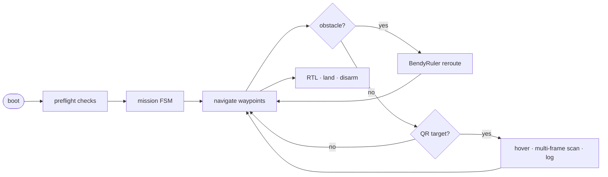

<div align="center">


[](https://python.org)
[](https://ardupilot.org)
[](https://ultralytics.com)
[](https://opencv.org)
[](https://raspberrypi.com)

</div>

---

## why it exists

this repo is the full onboard software stack for our Aerothon 2026 entry — the FSM, vision pipeline, obstacle avoidance, and everything in between, running on a Raspberry Pi 5.

## how it's built

<table>
<tr>
<td width="50%" valign="top">

**mission FSM**
`IDLE → TAKEOFF → NAVIGATE → AVOID → QR_SCAN → LAND`. each state has defined entry conditions, actions, and exit triggers. predictable and debuggable by design.

**obstacle avoidance**
BendyRuler algorithm handles path replanning. TF-Luna LiDAR feeds real-time proximity data. close range is LiDAR, mid-range is vision — layered so neither chokes the other.

**adapters**
abstraction layer over DroneKit/MAVLink. flight logic never calls MAVLink primitives directly — everything goes through adapters, making unit testing and sim swaps sane.

</td>
<td width="50%" valign="top">

**vision pipeline**
pyzbar for QR decoding with multi-frame validation — a code only confirms after N consistent reads across consecutive frames. killed a lot of false positives that way.

**simulation**
full SITL environment so the FSM and avoidance logic can be tested without the drone in the air. adapters make swapping real hardware for sim transparent.

**flight logs**
timestamped `.tlog` files from every test flight, replayable via Mission Planner or the included tools.

</td>
</tr>
</table>

## how it fits together



| part | location | role |
|---|---|---|
| mission entry | `main.py` | boots FSM, starts flight |
| state machine | `fsm/` | mission state management |
| flight control | `control/` | arm, takeoff, land, velocity primitives |
| MAVLink layer | `adapters/` | DroneKit/MAVLink abstraction |
| vision | `vision/` | YOLOv8 detection + QR pipeline |
| sensors | `drivers/` | LiDAR, camera, GPIO drivers |
| simulation | `sim/` | SITL environment |

<details>
<summary><b>full repo structure</b></summary>

```
aerothon-2026/
├── main.py              # entry point — boots FSM, starts flight
├── config.py            # all tunable parameters in one place
├── adapters/            # MAVLink / DroneKit wrappers
├── control/             # flight primitives (arm, takeoff, land, velocity)
├── data/                # waypoints, field maps, static assets
├── drivers/             # LiDAR, camera, GPIO drivers
├── flight_logs/         # telemetry from test flights
├── fsm/                 # mission state machine
├── sim/                 # SITL simulation environment
├── test/                # unit and integration tests
├── tools/               # calibration and diagnostic scripts
│   ├── calibrate_lidar.py
│   ├── camera_check.py
│   ├── log_replay.py
│   └── waypoint_gen.py
└── vision/              # YOLOv8 detection + QR pipeline
```

</details>

## quick start

you need Python 3.10+, ArduPilot SITL (for sim), and a Pixhawk-compatible flight controller (for hardware).

**1. clone**

```bash
git clone https://github.com/Prankyche/aerothon-2026.git
cd aerothon-2026
```

**2. install dependencies**

```bash
pip install -r requirements.txt
# dronekit · pymavlink · ultralytics · pyzbar · opencv-python
```

**3. configure**

key parameters in `config.py`:

```python
TAKEOFF_ALTITUDE     = 5.0   # meters
OBSTACLE_CLEARANCE_M = 1.5   # BendyRuler margin
QR_CONFIRM_FRAMES    = 5     # multi-frame validation threshold
LIDAR_WARN_DISTANCE  = 2.0   # TF-Luna trigger distance (m)
YOLO_CONFIDENCE      = 0.6   # detection threshold
```

**4. run in simulation (SITL)**

```bash
# terminal 1
sim_vehicle.py -v ArduCopter --console --map

# terminal 2
python main.py --sim
```

**5. run on hardware**

```bash
python main.py --port /dev/ttyAMA0 --baud 921600
```

## testing

```bash
pytest                     # everything
pytest test/ -k "sim"      # simulation only
pytest test/ -k "vision"   # vision pipeline only
```

covers: MAVLink adapter mocks, FSM state transitions, QR multi-frame validator, LiDAR driver parsing.

## roadmap

- [ ] cross-mission waypoint replanning based on live obstacle map
- [ ] onboard telemetry dashboard (Pi 5 display)
- [ ] multi-target QR sequencing
- [ ] improved low-light vision performance

## contributing

1. fork the repo
2. create a branch: `git checkout -b feature/your-change`
3. commit: `git commit -m "feat: describe the change"`
4. open a pull request
